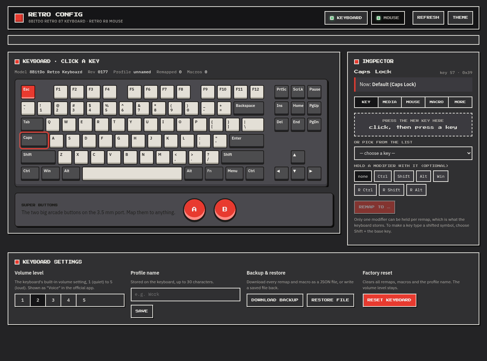
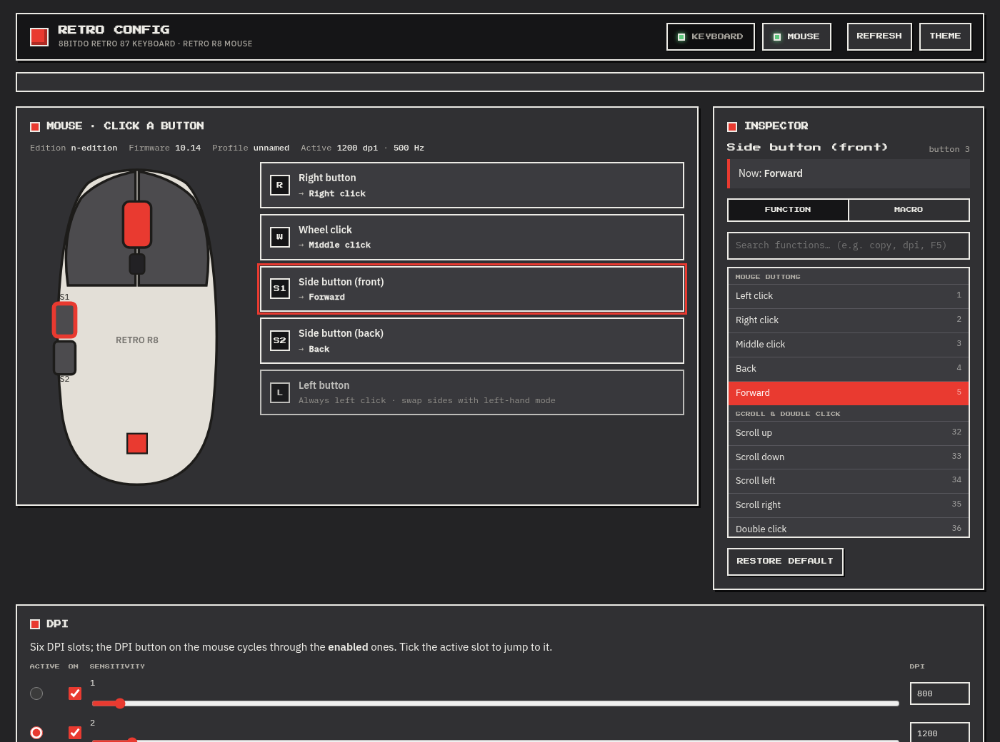

# 8BitDo Retro 87 keyboard & Retro R8 mouse on Linux

`8bitdo-cfg` configures the **8BitDo Retro Mechanical Keyboard (87 key)** and the
**8BitDo Retro R8 Mouse** from Linux. 8BitDo only ships "Ultimate Software V2"
for Windows/macOS; this tool speaks the same USB HID protocol, which was
reverse-engineered from that software (see `docs/PROTOCOL.md`).

It is pure Python 3 (stdlib only) and talks to `/dev/hidrawN` directly.
There is a command line (`8bitdo-cfg ...`) and a local web UI (`8bitdo-cfg ui`).




## What it can do

Keyboard (USB `2dc8:5200`, also `5201` via the 2.4 GHz receiver):

- read the full configuration (profile name, volume level, remaps, macros)
- remap any key to another key (with one modifier), to `fn`, to a media key
  (volume, play/pause, mail, calculator, brightness...) or to a mouse action
  (clicks, scroll)
- record up to 8 macros (200 key events each, delays, repeat count / hold,
  interval) bound to keys, including the Super Buttons (`super_a`, `super_b`)
- set the volume level (1..5), profile name, factory reset
- dump / apply the configuration as JSON

Mouse (USB `2dc8:5205`):

- read the full configuration and firmware/edition info
- DPI: six slots for X and Y (50..26000), enabled mask, active slot
- polling rate (250 / 500 / 1000 / 2000 / 4000 / 8000 Hz)
- lift-off distance, wheel speed, wheel direction, left-hand mode
- button functions for right, middle, all four side buttons and the wheel's
  up/down directions (all 250+ functions the official app offers: keys, media,
  DPI, scroll, macros...). The right-side pair ships disabled; map it to use it.
- macros on the four side buttons (80 events with per-event delays); the infinite
  mode loops until another button is pressed, it does not stop on release, and
  there is no "while held" mode (the `fire` function is a single click)
- profile name, factory reset, JSON dump / apply

Firmware updates are **not** implemented (the official app uses separate
DFU tools for that).

## Install

### NixOS (flake)

```nix
{
  inputs.eightbitdo.url = "github:ThatCrispyToast/8bitdo_linux";
  # ...
  nixosConfigurations.myhost = nixpkgs.lib.nixosSystem {
    modules = [
      eightbitdo.nixosModules.default
      { hardware.eightbitdo.enable = true; }   # installs 8bitdo-cfg + udev rule
    ];
  };
}
```

Or just run it: `nix run github:ThatCrispyToast/8bitdo_linux -- list`.

### Anywhere else

```
pip install .            # gives you the 8bitdo-cfg command
sudo cp udev/70-8bitdo.rules /etc/udev/rules.d/ && sudo udevadm control --reload && sudo udevadm trigger
```

The udev rule grants the logged-in (seat) user access to the two vendor HID
interfaces. Steam's udev rules already do this for all 8BitDo devices, so on
a machine with Steam installed it works without the rule.

From a checkout without installing: `python3 -m eightbitdo ...`.

## The UI

```
8bitdo-cfg ui            # starts a local server on 127.0.0.1:8765 and opens your browser
8bitdo-cfg ui --port 9000 --no-browser
```

Click a key on the keyboard drawing (or a Super Button) and the inspector on
the right lets you remap it to another key (press it on your keyboard, or pick
it, optionally with a modifier), a media function, a mouse action, the Fn
layer, or record a macro. Every change is written to the keyboard as you make
it and confirmed with a toast. Volume level, profile name, backup/restore and
factory reset sit below. The mouse page works the same way: click a button on
the diagram to change its function or macro, and set DPI slots, polling rate,
lift-off distance, wheel speed and direction, and left-hand mode underneath.
The theme follows your system; the Theme button overrides it.

The page only talks to `127.0.0.1` and refuses requests from other web sites,
so it is safe to leave running. With the NixOS module it also appears in the
application menu as "Retro Config". `python -m eightbitdo.server --export
demo.html` writes a standalone copy of the page with sample data.

## Command line

```
8bitdo-cfg list                       # show the HID interfaces that were found

8bitdo-cfg keyboard show              # current configuration
8bitdo-cfg keyboard map caps_lock left_ctrl
8bitdo-cfg keyboard map scroll_lock media:play_pause
8bitdo-cfg keyboard map super_a mouse:left
8bitdo-cfg keyboard map f12 shift+f12
8bitdo-cfg keyboard unmap caps_lock
8bitdo-cfg keyboard macro f24 --name "copy" --repeat 1 tap:ctrl+c delay:50 tap:ctrl+v
8bitdo-cfg keyboard macro super_b --name "spam" --repeat hold --interval 100 tap:space
8bitdo-cfg keyboard macro-clear f24
8bitdo-cfg keyboard volume 3
8bitdo-cfg keyboard profile-name "work"
8bitdo-cfg keyboard dump > keyboard.json ; 8bitdo-cfg keyboard apply keyboard.json
8bitdo-cfg keyboard reset --yes       # clears remaps, macros and the name
8bitdo-cfg keyboard keys              # key names ; `keyboard targets` lists remap targets

8bitdo-cfg mouse show
8bitdo-cfg mouse dpi 400 800 1600 3200 6400 12800 --enable 1,2,3,4
8bitdo-cfg mouse dpi-slot 3
8bitdo-cfg mouse rate 1000
8bitdo-cfg mouse lod 1                 # lift-off distance in mm (1 or 2)
8bitdo-cfg mouse wheel-speed 5         # 0..14
8bitdo-cfg mouse wheel-direction reversed
8bitdo-cfg mouse left-hand on
8bitdo-cfg mouse button side_front dpi_cycle
8bitdo-cfg mouse button side_back play_pause   # see `mouse functions` for all names
8bitdo-cfg mouse button right_front copy       # right-side pair (right_front / right_back), disabled from the factory
8bitdo-cfg mouse button wheel_up volume_up     # the wheel directions are remappable too (wheel_up / wheel_down)
8bitdo-cfg mouse button wheel_up scroll_up     # ...and this puts it back
8bitdo-cfg mouse macro side_back --name "dbl" click:left delay:80 click:left
8bitdo-cfg mouse macro-off side_back
8bitdo-cfg mouse dump > mouse.json ; 8bitdo-cfg mouse apply mouse.json
8bitdo-cfg mouse reset --yes
```

Macro steps: `press:KEY`, `release:KEY`, `tap:KEY` (press+release),
`tap:ctrl+c` (modifier combos), `delay:MS`. Mouse macros also accept
`click:left|right|middle|back|forward`; there `delay:MS` sets the pause after
the previous event (the device default is 10 ms).

Key names: letters, digits, `f1`..`f24`, `enter esc backspace tab space minus
equal left_bracket right_bracket backslash semicolon quote grave comma period
slash caps_lock print_screen scroll_lock pause insert home page_up delete end
page_down right left down up num_lock kp_1..kp_0 kp_slash kp_asterisk kp_minus
kp_plus kp_enter kp_period left_ctrl left_shift left_alt left_gui right_ctrl
right_shift right_alt right_gui application`, plus the keyboard's extra
physical keys `super_a super_b` (Super Buttons) and `k1`..`k8`.

## Python API

```python
from eightbitdo.retro87 import Retro87
from eightbitdo.r8mouse import R8Mouse

with Retro87.open() as kb:
    kb.map_key(0x39, 0xE0)              # caps lock -> left ctrl (HID usages)
    print(kb.read_config())

with R8Mouse.open() as m:
    m.set_wheel_speed(5)
    print(m.get_dpi(0), m.get_rate())
```

## Development

```
nix develop            # python with pytest
python3 -m unittest discover -s tests
nix build              # builds the package and runs the tests
```

`resources/` holds the Windows software the protocol was derived from
(ignored by git).
